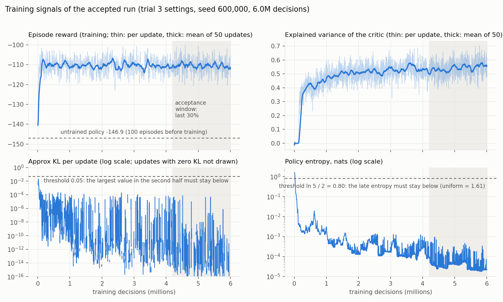

# GeoAI-for-Fire-Trucks-Dispatching

Code for a SimPy simulator of fire-engine dispatch in Gainesville and Alachua County, Florida. It replays the FY2025
engine dispatches of Gainesville Fire Rescue and Alachua County Fire Rescue, checks the simulator against that record,
compares dispatch policies, and generates synthetic scenarios for training a dispatch policy. The data are not stored
here; the first script downloads them.

## Requirements

Python 3.13 with simpy, pandas, numpy, pyarrow, geopandas, shapely, pyproj, osmnx, networkx, scipy, scikit-learn and
requests. The notebook also needs jupyter and matplotlib. Tested with simpy 4.1.2, pandas 3.0.1, numpy 2.4.2,
geopandas 1.1.3, osmnx 2.1.0, networkx 3.6.1, scipy 1.15.3 and scikit-learn 1.6.1. The learned dispatcher also needs
gymnasium 1.2.3, stable-baselines3 2.9.2, sb3-contrib 2.9.2, torch 2.10.0 and optuna 5.0.0.

Run every command from the repository root. The scripts read and write under `data/`, which they create.

## Steps

**1. Download the inputs** into `data/raw/gnv_alachua/`:

    python -I code/data_collection/fetch_gnv_alachua_layers.py

With no arguments it downloads every layer not yet on disk, then writes a README in that folder with the sources and
any layer that failed. To download only the files the steps below use, name them:

    python -I code/data_collection/fetch_gnv_alachua_layers.py \
        acfr_gfr_unit_responses_fy2025.parquet acfr_gfr_automatic_aid_fy2025.parquet \
        acfr_gfr_automatic_aid_fy2024.parquet gfr_stations_2022.gpkg acdps_fire_ems_stations_2025.gpkg \
        gainesville_city_limits_2026.gpkg alachua_county_boundary.gpkg census2020_blocks_alachua.gpkg \
        alachua_drive.graphml

**2. Build the engine dispatch table:**

    python code/data_collection/build_engine_dispatches_fy2025.py

Writes `engine_dispatches.parquet` (one row per engine dispatch), `engines.csv` and `stations.csv` to
`data/derived/engine_dispatches_fy2025/`. It also reads `data/derived/gfr_soc_2024/dashboard/appendix_e_crosswalk.csv`
(call code to risk level, from Appendix E of the GFR Standards of Cover 2024), which no script here produces.

**3. Run the simulator:**

    python code/dispatch_simulator/main.py

Runs every step in order (about 50 minutes) and writes its tables to `data/reports/dispatch_simulator/`: the checks of
each fitted input, the simulator against the 2025 record, first-due coverage and fire readiness, the opportunity-cost
rule against the protocol, and the synthetic scenarios with their stress conditions.

The simulator is split by role, so that a learned policy can plug into it:

| File | What it holds |
|---|---|
| `environment.py` | the record, road travel times, the fitted inputs, `build_world()` and `simulate(world, scenario, policy)` |
| `policies.py` | dispatch policies: the protocol (`closest_engine`) and the opportunity-cost rule |
| `scenarios.py` | the synthetic scenario generator and its stress conditions |
| `measures.py` | the checks against the record and the comparisons of policies and scenarios |
| `main.py` | runs every step and writes the tables |
| `rl_env.py` | the learned dispatcher's environment: one synthetic day per episode, every dispatch decided by the agent |
| `e2_small_system.py` | the learnability gate: a three-station system whose optimal policy is known exactly |
| `train.py` | the gate, the ASHA searches over PPO settings, and the final training run with its acceptance check |

A policy is a function `policy(world, scenario, run, available_engines, travel_s, context)` that returns the engine to send, or
`None` to let the run wait.

**4. Step log (optional):**

    jupyter notebook code/dispatch_simulator/steps.ipynb

Shows each function's inputs and outputs on concrete cases and the evidence of a run. Run step 3 first; the notebook
reads its tables and takes a few minutes.

**Describe the 2025 dispatches (optional):**

    python code/analysis/describe_engine_dispatches_fy2025.py

Writes descriptive tables of the record to `data/reports/engine_dispatches_fy2025/`.

## Learned dispatcher (reinforcement learning)

An agent decides every dispatch of a synthetic day. At each dispatch it picks one of the five closest eligible free
engines, from 207 numbers describing the call, the time of day, the coverage of the system, the five candidates and
every engine. The reward charges each arrival its call class weight times the minutes from the call (study fires 8,
high-acuity medical 1, low-acuity 0.5, other 1; a call's later arrivals at half weight), and a run released with no
engine its wait. A potential-based term moves each sent run's estimated cost to the decision that sent it, because
almost half of the arrivals come after the next decision. Training uses MaskablePPO (sb3-contrib) on episodes of one
synthetic day drawn from October to March, under six conditions (nominal, more calls, short surges, engines out, a
closed station, a large fire).

**Train** (run from the repository root; each step writes to `data/models/dispatch_rl/`):

    python code/dispatch_simulator/train.py e2-search    # ASHA over PPO settings on a three-station system with a known optimum (about 15 minutes)
    python code/dispatch_simulator/train.py e2-gate      # the learnability gate: retrain the best settings on fresh seeds and compare with the exact optimum
    python code/dispatch_simulator/train.py search       # ASHA over PPO settings on the full environment (hours)
    python code/dispatch_simulator/train.py final 3 600000 final_preregistered    # the accepted run: trial 3's settings, seed 600,000, 6M decisions (about 3.3 hours on 8 cores)

The final run measures the untrained policy's reward on 100 episodes, trains with a validation every 200,000 decisions
and a saved copy of the model every 500,000, then writes the model, the training signals (`progress.csv`) and the
acceptance table.

**Use the accepted model:**

```python
import sys
sys.path.insert(0, "code/dispatch_simulator")
from sb3_contrib import MaskablePPO
import train

model = MaskablePPO.load("data/models/dispatch_rl/final_preregistered/model")
days = train.Evaluator().compare(model)    # 12 fixed synthetic validation days: protocol, closest engine and agent returns
print(days[["condition", "improvement", "improvement over closest", "closest agreement"]])
```

Inside the environment, `model.predict(observation, action_masks=env.action_masks(), deterministic=True)` returns the
slot (0 to 4) of the engine to send; `rl_env.DispatchEnv` builds the observation and the mask.

**Uploaded results** (`data/models/dispatch_rl/`): `final_preregistered/` holds the accepted model (`model.zip`), its
settings, the untrained policy's reward, the training signals, the acceptance table, and the returns on the validation
panel and on an independent panel of 12 days; `dispatch_search_trials.csv` and `e2_search_trials.csv` hold the two
ASHA searches.

**Training signals of the accepted model** (shaded: the last 30% of training, which the acceptance checks read):



The acceptance rule was fixed before this run, and all ten checks pass. The episode reward rises from the untrained
policy's -146.9 to -110.5 and stays level (its late trend changes by 2.4% of the rise). The critic's explained variance
reaches 0.54 and does not fall. The largest approx KL in the second half is 0.0004, against a limit of 0.05. The policy
entropy falls from 1.61 nats to 0.00006 without drifting back up. On both validation panels, the trained policy takes
the closest candidate at every decision. It beats the protocol by 0.130 and 0.067 reward units per day only because
the reward does not value engine type, so it skips the protocol's quint rule.

## Lombok base model

    python code/reproduce_simulator.py

The dispatch simulator started from this minimal SimPy version of the Lombok queue-recovery model (Alisjahbana &
Kiremidjian 2021, github.com/ialsjbn/queue-recovery). It needs `lombok_data.pkl` from that repository: set
`BNPB_PICKLE` at the top of the file to its path. It runs in about 5.5 minutes and writes to
`data/reports/reproduce_simulator/`.
